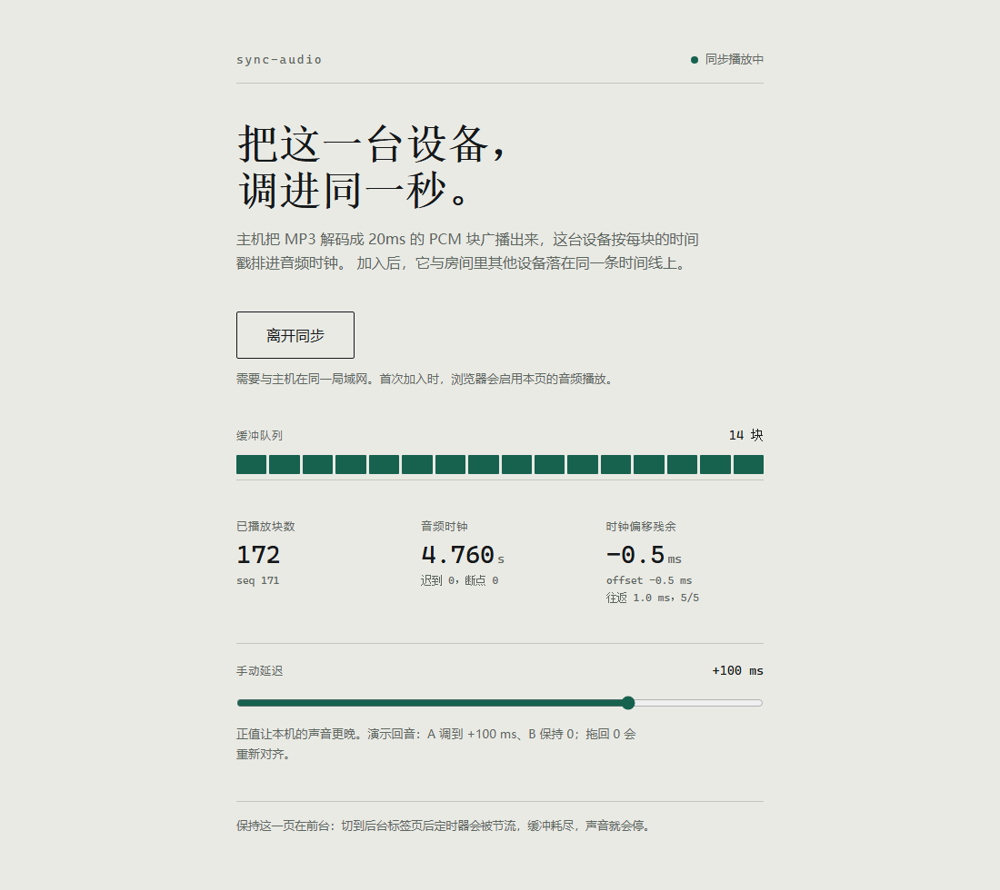

# SyncAudio

**把一台电脑正在播放的声音，同步送到局域网 / 公网上的其他设备。**

主机端采集默认播放设备（WASAPI 环回）或解码上传的 MP3，切成 20ms 的 PCM 块，通过 WebSocket 广播；浏览器按时间戳排程播放。时钟用简化 NTP 校正，高延迟网络自动切换到 WebRTC/Opus。

界面分为两个入口：

- **客户端**（`/`）：输入房间密码加入，只保留时钟偏移和手动延迟两项控制。
- **主机控制台**（`/host`）：输入管理密码登录，查看运行状态、启停共享、修改房间密码，以及播放控制（当前曲目、上一首/下一首、上传曲目）。



## 特性

- **本机声音共享**：抓取当前默认播放设备（USB / 蓝牙 / HDMI / 板载声卡均可），无需切换设备、无需安装虚拟声卡驱动。
- **房间密码**：客户端必须输入正确的房间密码才能接入音频，密码随机会话、12 小时有效。
- **管理密码**：`/host` 控制台独立鉴权，房间密码与共享开关只有管理员能改。
- **MP3 播放**：上传后由 FFmpeg 流式解码为 PCM，按实时节拍广播。
- **曲目控制**：控制台显示当前曲名与序号，支持上一首/下一首、上传即播，播完自动切下一首。
- **音源切换**：控制台可在「本机声音」与「曲库」之间切换，切换时自动停掉旧音源。
- **暂停 / 继续**：暂停本机声音或文件播放；文件续播时用 `-ss` 从暂停位置继续。
- **时钟同步**：5 次握手取中位数，之后每 30 秒用 RTT 最小样本渐进重校，抵消晶振漂移。
- **精确排程**：20ms 块 + `scheduledTime`，局域网内多设备对齐在毫秒级。
- **自适应抖动缓冲**：按丢块情况自动调整排程提前量，公网抖动时自动加深缓冲。
- **混合传输**：RTT ≤ 80ms 走 PCM over WebSocket；更高延迟自动切 WebRTC/Opus（约 50kbps）。
- **手动微调**：±200ms 滑杆，值会记住；用于对齐主机扬声器或补偿 iOS 输出延迟。
- 无前端框架、无 Express；运行时依赖只有 `ws`、`werift`、`opusscript`。

## 架构

```
┌──────────────┐   WASAPI loopback   ┌──────────────┐   20ms PCM 块     ┌──────────────┐
│ 默认播放设备 │ ──────────────────► │  loopback    │ ────────────────► │              │
└──────────────┘   (内嵌 C# 采集器)  │  capture.exe │                   │   Node 服务  │
                                    └──────────────┘                   │              │
┌──────────────┐      FFmpeg 解码                                       │  · 分块 1764B │
│ uploads/*.mp3│ ───────────────────────────────────────────────────► │  · 时钟/心跳  │
└──────────────┘                                                       │  · WS 广播    │
                                                                       │  · Opus 出口  │
                                                                       └──────┬───────┘
                                                                              │
                            ┌─────────────────────────────────────────────────┴──────────┐
                            │                                                                 │
                    PCM over WebSocket（局域网）                              WebRTC / Opus（公网）
                            │                                                                 │
                   ┌────────┴────────┐                                        ┌───────────────┴──────────┐
                   │ 浏览器 AudioContext │                                     │ RTCPeerConnection        │
                   │ 块级精确排程         │                                     │ 浏览器 jitter buffer     │
                   └─────────────────┘                                        └──────────────────────────┘
```

## 环境要求

- **Windows 10/11**（系统声音采集依赖 WASAPI；其他平台的采集尚未实现）
- **Node.js ≥ 18**
- **FFmpeg**（解码 MP3 / 重采样）。依次查找 `FFMPEG_PATH`、`PATH`、`%LOCALAPPDATA%\ffmpeg\bin`、`C:\ffmpeg\bin`
- **.NET Framework 4.x**（系统自带 `csc.exe`，首次运行自动编译采集器，产物在 `%LOCALAPPDATA%\sync-audio\`）

## 快速开始

```powershell
git clone https://github.com/zjw0810/sync-audio.git
cd sync-audio
npm install
node server/index.js
```

启动后终端会打印两个密码和两个地址：

```
[SYS] 房间密码: 760029
[SYS] 管理密码: a5c1b76fd470
[SYS] 主机控制台: http://localhost:3000/host
[SYS] 客户端页面: http://localhost:3000/
```

- **客户端**：手机/其他电脑打开 `http://<电脑IP>:3000`，输入房间密码加入。
- **主机控制台**：`http://localhost:3000/host`，输入管理密码登录。

密码首次运行随机生成，保存在 `%LOCALAPPDATA%\sync-audio\settings.json`；也可以用环境变量 `ROOM_PASSWORD` / `ADMIN_PASSWORD` 覆盖。

## 使用

### 共享本机声音

服务启动后自动采集默认播放设备，无需额外操作。默认设备被切换（插拔耳机、切虚拟声卡）时，服务端会在 5 秒内自动跟随并在日志中打印：

```
[SHARE] 默认播放设备已切换：「旧设备」→「新设备」，重新采集
```

### 播放上传的 MP3

需要管理员会话（先登录 `/host`），或在同源页面里带 cookie 调用：

```powershell
curl.exe -b cookies.txt -F "file=@music.mp3" http://localhost:3000/upload
curl.exe -b cookies.txt -X POST -H "Content-Type: application/json" -d '{"filename":"music.mp3"}' http://localhost:3000/play
```

文件播放结束后会自动回到本机声音共享。

### 主机自己也想听

客户端页面会把收到的音频输出到浏览器的默认输出设备。如果默认输出正是被采集的设备（例如虚拟声卡），会形成回环；这时：

- 把 Windows 默认输出设为真实扬声器，再用「音量合成器」把音频源应用单独指到虚拟声卡；或
- 主机不加入房间，只让其他设备听。

### 传输模式

| 参数 | 行为 |
|---|---|
| 默认 | RTT ≤ 80ms 用 PCM/WS，否则自动切 WebRTC |
| `?transport=ws` | 强制 PCM over WebSocket（同步最精确） |
| `?transport=rtc` | 强制 WebRTC/Opus（抗抖动，带宽最低） |

状态栏显示“同步播放中 · WebRTC”以示区分。

## HTTP 接口

| 方法 | 路径 | 鉴权 | 说明 |
|---|---|---|---|
| `GET` | `/` | 否 | 客户端页面 |
| `GET` | `/host` | 否 | 主机控制台页面 |
| `POST` | `/api/join` | 否 | `{"password":"..."}`，成功后种下 12 小时会话 Cookie |
| `POST` | `/api/admin/login` | 否 | `{"password":"..."}`，管理员会话 |
| `POST` | `/api/admin/logout` | 管理员 | 退出登录 |
| `GET` | `/api/session` | 否 | `{"role":"room"|"admin"|null}` |
| `GET` | `/api/admin/settings` | 管理员 | 采集设备、在线数、共享状态、房间密码 |
| `POST` | `/api/admin/settings` | 管理员 | `{"roomPassword":"..."}`，修改后踢掉所有房间会话 |
| `POST` | `/api/admin/share` | 管理员 | `{"enabled":true|false}` 启停共享 |
| `GET` | `/api/admin/now-playing` | 管理员 | 当前曲目、序号、总数、模式（file/system/idle） |
| `POST` | `/api/admin/player/next` | 管理员 | 下一首（当前为本机声音时从第一首开始） |
| `POST` | `/api/admin/player/prev` | 管理员 | 上一首（当前为本机声音时从最后一首开始） |
| `POST` | `/api/admin/player/pause` | 管理员 | `{"paused":true|false}`，省略则切换 |
| `POST` | `/api/admin/player/source` | 管理员 | `{"source":"system"|"library"}` 切换音源 |
| `POST` | `/upload` | 管理员 | multipart 字段 `file`，返回 `{"filename":"..."}` |
| `POST` | `/play` | 管理员 | JSON `{"filename":"..."}` |
| `GET` | `/status` | 管理员 | `{sharing, kind, device, clients, level, ffmpeg}` |

## WebSocket 协议

未携带有效会话 Cookie 的连接会以 `4001` 关闭。音频每块先发二进制 PCM（Int16、44100Hz、单声道、1764 字节 = 20ms），紧接着发 JSON：

```json
{"seq":0,"scheduledTime":1730000000000,"sampleRate":44100,"channels":1,"blockDurationMs":20}
```

| 消息 | 方向 | 作用 |
|---|---|---|
| `{"type":"sync","t1":...}` | C→S | 简化 NTP 请求 |
| `{"type":"sync_reply","t1":...,"t2":...}` | S→C | 立刻回填服务端时间 |
| `{"type":"heartbeat","serverTime":...}` | S→C | 每 2 秒，用于显示时钟偏差 |
| `{"type":"rtc_start"}` | C→S | 请求建立 WebRTC |
| `{"type":"rtc_offer","sdp":...}` / `rtc_answer` | 双向 | SDP 交换 |
| `{"type":"rtc_ice","candidate":...}` | 双向 | ICE 候选 |

时钟约定：所有时间戳均为 `Date.now()` 毫秒；`scheduledTime = 广播时刻 + 预缓冲`（本机声音 150ms，文件 300ms）。

## 配置

| 环境变量 | 默认 | 说明 |
|---|---|---|
| `ROOM_PASSWORD` | 随机 6 位 | 房间密码 |
| `ADMIN_PASSWORD` | 随机 12 位 | 管理密码 |
| `FFMPEG_PATH` | `ffmpeg` | FFmpeg 可执行文件路径 |
| `SYNC_LIVE_PREBUFFER_MS` | `150` | 本机声音预缓冲；公网建议 300–500 |

## 目录结构

```
server/
  index.js              HTTP + WebSocket + 鉴权 + 路由 + 心跳
  rtc.js                WebRTC / Opus 出口
  audio/decoder.js      MP3 解码 + WASAPI 环回采集（内嵌 C# 采集器）
  audio/broadcaster.js  20ms 分块、节拍、广播、时钟补偿
client/
  index.html            客户端：密码加入 + 时钟偏移 + 手动延迟
  host.html             主机控制台：状态 / 共享开关 / 房间密码
  css/app.css           共用样式
  js/ws.js              连接、配对、NTP 校时、RTC 信令
  js/scheduler.js       缓冲队列、排程、输出延迟补偿
  js/ui.js              客户端逻辑
  js/host.js            主机控制台逻辑
uploads/                上传的音频
```

## 已知限制

- 系统声音采集仅支持 Windows。
- 没有 TLS：公网部署请在前面加 Nginx/Caddy 并启用 HTTPS/WSS。
- 密码只有会话级防护，未做失败次数限制；公网部署建议再加一层反向代理鉴权。
- 页面切到后台后定时器被节流，会断流；请保持前台。
- Safari 不暴露 `outputLatency`，iOS 需要手动补偿（滑杆值会持久化）。
- WebRTC 模式下由浏览器 jitter buffer 决定延迟，跨设备对齐约 20–50ms（PCM 模式约 1ms）。
- 公网部署若服务器有公网 IP 通常不需要 TURN；对称 NAT 等特殊网络仍需中继。

## Roadmap

- [ ] 登录失败限流与 CSRF 防护
- [ ] 多房间
- [ ] AudioWorklet 环形缓冲，替换逐块 `AudioBufferSourceNode`
- [ ] 非 Windows 平台的采集（macOS / Linux）

## 参考

- [snapcast](https://github.com/snapcast/snapcast) — 多房间音频同步的经典实现
- [beatsync](https://github.com/freeman-jiang/beatsync) — 浏览器多设备同步播放
- [gophercast](https://github.com/shricodev/gophercast) — 局域网同步扬声器

## License

[MIT](LICENSE)
